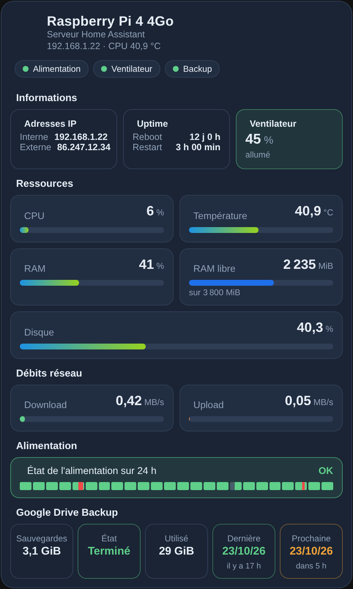
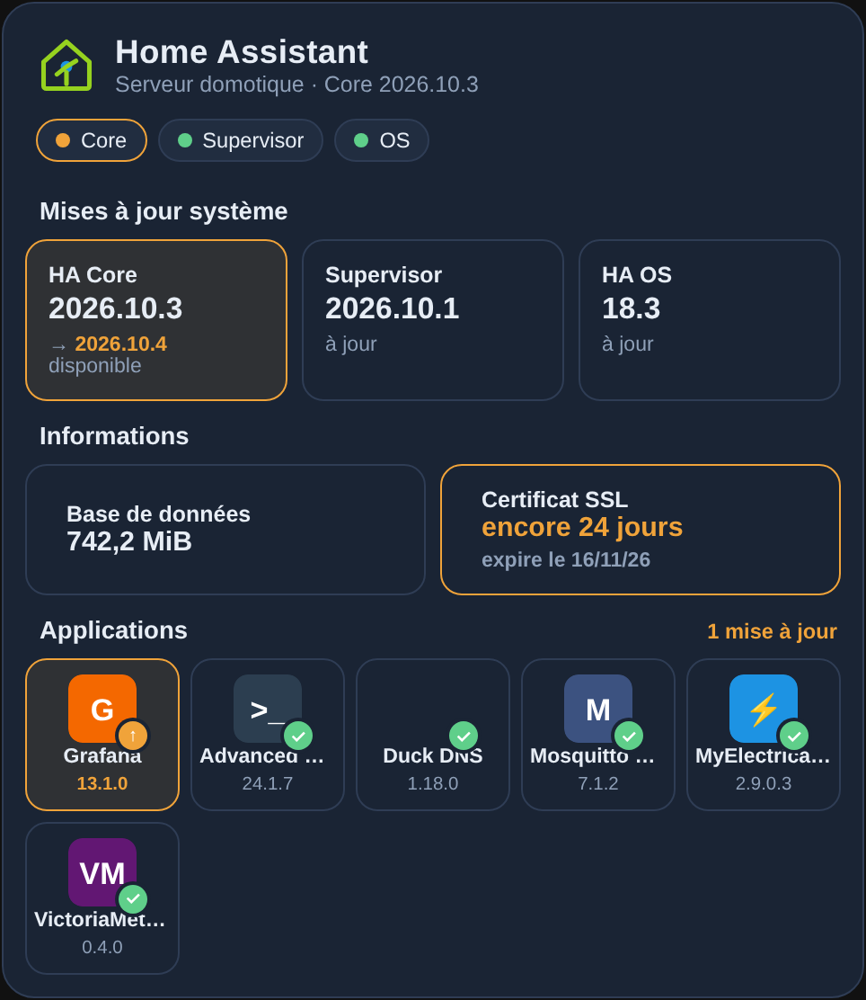
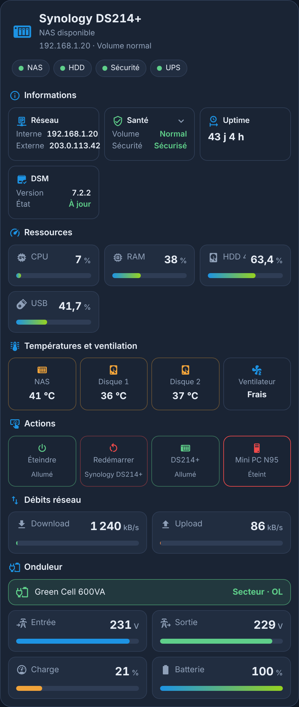
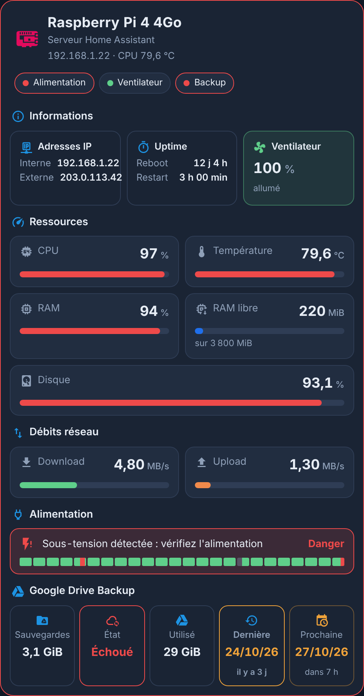
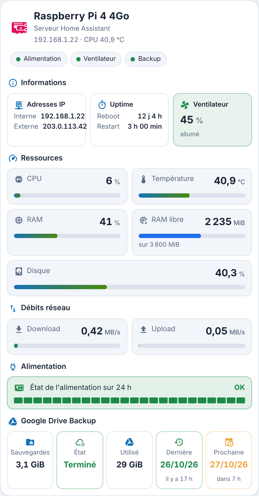
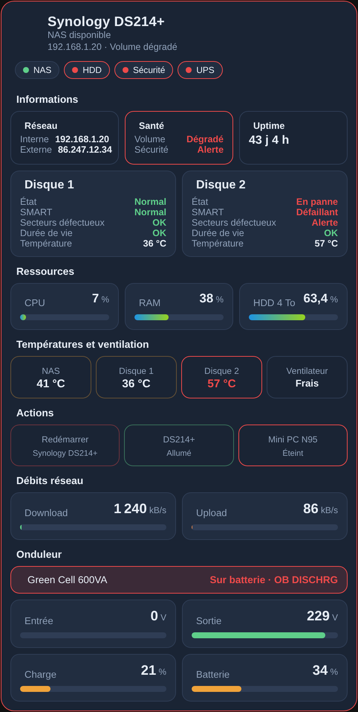

# Cartes Serveur HA

**Trois cartes Lovelace indépendantes, dans un seul fichier**, pour surveiller l'infrastructure de Home Assistant. Elles ont le style des cartes MyElectricalData new ([Carte Enedis Linky New](https://github.com/Marlboro62/content-card-linky-new)) : thème bleu nuit, version claire, ou thème Home Assistant.

| Type | Carte |
| --- | --- |
| `custom:serveur-ha-card` | **Serveur** (Raspberry Pi, mini-PC, VM) : CPU, température, RAM, disque, réseau, uptime, ventilateur, alimentation sur 24 h, sauvegardes et Google Drive |
| `custom:serveur-ha-maj-card` | **Home Assistant** : version, mises à jour Core / Supervisor / OS, base de données, certificat SSL et applications |
| `custom:serveur-ha-nas-card` | **NAS Synology** : santé des volumes et disques, CPU, RAM, températures, ventilateur, actions, réseau et onduleur |

**Aucune dépendance** : pas de button-card, pas de browser_mod, pas d'image ni de page HTML à déposer dans `/local`. Les capteurs sont **détectés automatiquement**, en français comme en anglais, et chaque élément sans capteur est simplement masqué.

| Serveur | Home Assistant | NAS Synology |
| --- | --- | --- |
|  |  |  |

| Serveur en alerte | Clair | NAS en alerte |
| --- | --- | --- |
|  |  |  |

*Aperçus réalisés avec des valeurs fictives.*

**[▶ Essayer la démo en ligne](https://marlboro62.github.io/serveur-ha-card/docs/demo.html)** : les 3 cartes avec des données simulées (Raspberry Pi ou VM, mises à jour, certificat SSL, NAS sain ou en panne, coupure de courant), en sombre ou clair, sur téléphone ou PC, avec le YAML à copier.

## Installation

### Avec HACS (recommandé)

1. Dans HACS, menu **⋮** → **Dépôts personnalisés**.
2. Ajoutez `https://github.com/Marlboro62/serveur-ha-card` avec le type **Tableau de bord** (Dashboard).
3. Cherchez **Cartes Serveur HA**, installez, puis rechargez la page (Ctrl+F5).

> Tant qu'il n'existe qu'une version bêta, activez **Afficher les versions bêta** dans la fenêtre de téléchargement de HACS.

### Manuellement

1. Téléchargez [`serveur-ha-card.js`](https://raw.githubusercontent.com/Marlboro62/serveur-ha-card/main/serveur-ha-card.js) (clic droit → Enregistrer sous) et copiez-le dans `/config/www/`.
2. **Paramètres → Tableaux de bord → ⋮ → Ressources → Ajouter une ressource** : URL `/local/serveur-ha-card.js`, type **Module JavaScript**.
3. Rechargez la page (Ctrl+F5).

Toutes les cartes ont un **éditeur visuel** et acceptent `theme` : `v2` (bleu nuit MyElectricalData), `auto` (clair ou sombre selon Home Assistant) ou `ha` (thème Home Assistant).

---

## Carte Serveur — `custom:serveur-ha-card`

```yaml
type: custom:serveur-ha-card
title: Raspberry Pi 4 4Go
icon: mdi:raspberry-pi
icon_color: "#E30B5D"
ram_total: 3800
```

### Ce qu'elle affiche

- **En-tête** : nom, IP et température CPU, avec les voyants **Alimentation**, **Ventilateur** et **Backup**.
- **Informations** : adresses IP interne et externe, uptime (dernier reboot et dernier redémarrage de HA), ventilateur.
- **Ressources** : CPU, température, RAM, RAM libre et disque, avec des jauges colorées selon des seuils.
- **Débits réseau** : download et upload.
- **Alimentation** : historique des **24 dernières heures** en 24 segments d'une heure (vert = OK, rouge = sous-tension, gris = inconnu), avec la durée de chaque état au survol.
- **Sauvegardes / Google Drive Backup** : taille des sauvegardes, état de la dernière sauvegarde automatique, espace utilisé, dates de la dernière et de la prochaine.

### Capteurs détectés

| Élément | Intégration | Exemple d'entité |
| --- | --- | --- |
| CPU, température, RAM, RAM libre, disque, débits, dernier démarrage | **System Monitor** | `sensor.system_monitor_utilisation_du_processeur` |
| Disque (repli sans System Monitor) | Supervisor | `sensor.home_assistant_host_disk_used` |
| IP interne | **Local IP** ou System Monitor | `sensor.local_ip` |
| IP externe | **DNS IP**, ou attribut `wan_ipaddress` / `external_ip` d'un routeur | `binary_sensor.wan_status` |
| Redémarrage de HA | **Uptime** (nom libre) | `sensor.temps_online` |
| Alimentation | **Raspberry Pi Power Supply Checker** | `binary_sensor.rpi_power_status` |
| Ventilateur | une entité `fan.*` (ex. `fan.rpi_cooling_fan`), ou un capteur en rpm ou % via `fan:` | `fan.rpi_cooling_fan` |
| Sauvegardes | **Sauvegarde** (backup) | `event.backup_sauvegarde_automatique` |
| Google Drive | **Google Drive** | `sensor.xxx_used_storage` |

Les capteurs de System Monitor sont souvent **désactivés par défaut** : activez-les dans **Paramètres → Appareils et services → System Monitor**.

### Options

| Option | Rôle | Défaut |
| --- | --- | --- |
| `title`, `subtitle` | Titre et sous-titre | `Serveur`, `Serveur Home Assistant` |
| `icon`, `icon_color` | Icône de l'en-tête et sa couleur | logo de la carte |
| `fan` | Ventilateur : `fan.*` ou capteur en rpm / % | détecté (`fan.*rpi*`, `*cooling*`…) |
| `ram_total` | RAM totale en MiB : la barre « RAM libre » devient libre / total | — |
| `net_max` | Pleine échelle des barres réseau (Mbit/s) | `100` |
| `cpu_warn` / `cpu_alert`, `ram_warn` / `ram_alert`, `disk_warn` / `disk_alert` | Seuils orange / rouge en % | `70/90`, `75/90`, `75/90` |
| `temp_warn` / `temp_alert` | Seuils de température | `60` / `75` °C |
| `backup_title` | Titre de la section sauvegardes | `Google Drive Backup` si Google Drive, sinon `Sauvegardes` |
| `navigation_path` | Page ouverte en cliquant sur le titre | fiche de l'IP |
| `ip_ext_attribute` | Attribut portant l'IP externe | détecté |
| `show_info`, `show_resources`, `show_network`, `show_power`, `show_backup` | Afficher chaque section | `true` |
| `entities` | Capteurs choisis à la main (voir ci-dessous) | — |

Clés de `entities:` : `cpu`, `temperature`, `ram`, `ram_free`, `disk`, `disk_used`, `disk_total`, `net_in`, `net_out`, `ip`, `ip_ext`, `last_boot`, `ha_start`, `power`, `fan`, `backup_state`, `backup_event`, `backup_last`, `backup_next`, `drive_size`, `drive_used`, `drive_total`, `drive_count`.

Un **appui long** sur la tuile du ventilateur (entité `fan.*`) l'allume ou l'éteint.

---

## Carte Home Assistant — `custom:serveur-ha-maj-card`

```yaml
type: custom:serveur-ha-maj-card
```

- **En-tête** : version du Core, voyants **Core**, **Supervisor** et **OS** (vert = à jour, orange = mise à jour disponible).
- **Mises à jour système** : version installée et nouvelle version disponible.
- **Informations** : taille de la base de données (`sensor.*_db_size`) et expiration du **certificat SSL** (intégration *Certificate Expiry*), vert au-delà de 30 jours, orange en dessous, rouge sous 20 jours.
- **Applications** : les mises à jour des **add-ons**, trouvées automatiquement avec leur icône, celles à mettre à jour en premier.

| Option | Rôle | Défaut |
| --- | --- | --- |
| `title`, `subtitle` | Titre et sous-titre | `Home Assistant`, `Serveur domotique` |
| `database`, `ssl` | Capteurs de la base et du certificat | détectés |
| `ssl_warn` / `ssl_alert` | Seuils du certificat, en jours | `30` / `20` |
| `include_hacs` | Ajouter les mises à jour HACS | `false` |
| `include_devices` | Ajouter les firmwares d'appareils (Zigbee, ESPHome…) | `false` |
| `apps` | Liste choisie à la main (`entity`, `name`, `icon`, `picture`) | add-ons détectés |
| `exclude` | Entités `update.*` à masquer | — |
| `updates_first` | Mises à jour en attente en premier | `true` |
| `show_system`, `show_info`, `show_apps` | Afficher chaque section | `true` |

---

## Carte NAS Synology — `custom:serveur-ha-nas-card`

```yaml
type: custom:serveur-ha-nas-card
title: Synology DS214+
volume_name: HDD 4 To
ups_name: Green Cell 600VA
actions:
  - switch.ds214
  - entity: switch.minipc
    name: Mini PC N95
```

- **En-tête** : NAS disponible ou non, IP, état du volume, voyants **NAS**, **HDD**, **Sécurité** et **UPS**.
- **Informations** : adresses IP, santé (volume, sécurité), uptime. Un clic sur **Santé** ouvre l'**état de chaque disque** (état, SMART, secteurs défectueux, durée de vie, température).
- **Ressources** : CPU, RAM et chaque volume.
- **Températures et ventilation** : NAS et chaque disque (orange à 45 °C, rouge à 55 °C), mode du ventilateur (**appui long** : mode suivant).
- **Actions** : **Redémarrer** (confirmation en deux clics) et vos interrupteurs (**appui long** : marche / arrêt).
- **Débits réseau** et **onduleur** NUT : état, tension d'entrée et de sortie, charge, batterie.

Les entités sont trouvées via l'intégration **Synology DSM**, pour **tous les volumes et tous les disques**. Les états (Normal, Dégradé, En panne…) sont traduits en français.

| Option | Rôle | Défaut |
| --- | --- | --- |
| `device` | Appareil Synology DSM | le premier trouvé |
| `prefix` | Préfixe des entités, si le registre ne suffit pas | `diskstation` |
| `title`, `icon`, `icon_color` | En-tête | nom de l'appareil, `mdi:nas` |
| `tracker` | `device_tracker` du NAS (adresse IP) | détecté |
| `volume_name` | Nom du volume 1 | `Volume 1` |
| `fan` | Mode du ventilateur (`select`) | détecté |
| `reboot` | Bouton de redémarrage (`null` pour le masquer) | détecté |
| `actions` | Interrupteurs et boutons (`entity`, `name`, `icon`) | — |
| `ups_device`, `ups_name`, `ups` | Onduleur NUT (appareil, nom, capteurs) | le premier trouvé |
| `net_max` | Pleine échelle des barres réseau (Mbit/s) | `1000` |
| `temp_warn` / `temp_alert` | Seuils de température | `45` / `55` °C |
| `navigation_path` | Page ouverte en cliquant sur le titre | — |
| `show_info`, `show_resources`, `show_thermal`, `show_actions`, `show_network`, `show_ups` | Afficher chaque section | `true` |

D'autres exemples sont dans [`exemples/`](exemples/).

## Support

Questions et problèmes : uniquement via les [issues GitHub](https://github.com/Marlboro62/serveur-ha-card/issues).

## Voir aussi

[Carte Onduleur UPS](https://github.com/Marlboro62/onduleur-ups-card) · [Carte Enedis Linky New](https://github.com/Marlboro62/content-card-linky-new) · [Cartes Linky Énergie](https://github.com/Marlboro62/linky-energie-cards)

Si les cartes vous sont utiles : [Buy Me a Coffee](https://buymeacoffee.com/marlboro62) · [Ko-fi](https://ko-fi.com/nothing_one)

## Licence

MIT
