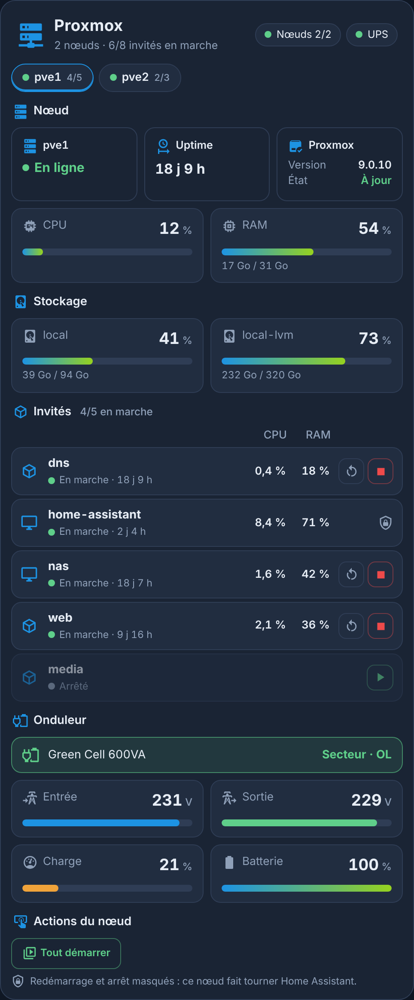
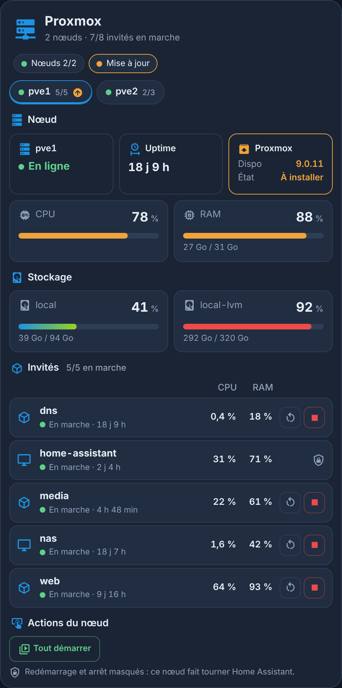
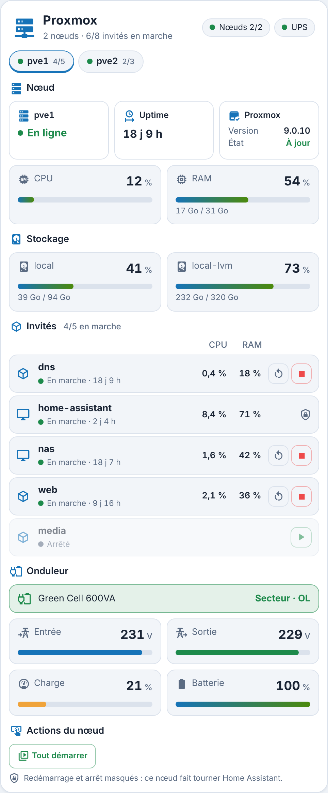
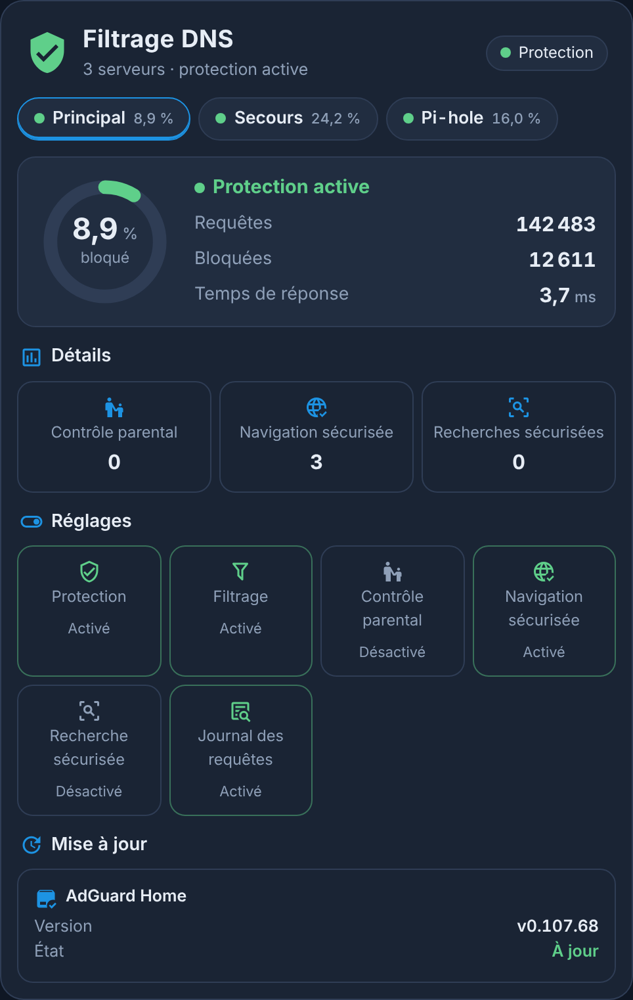
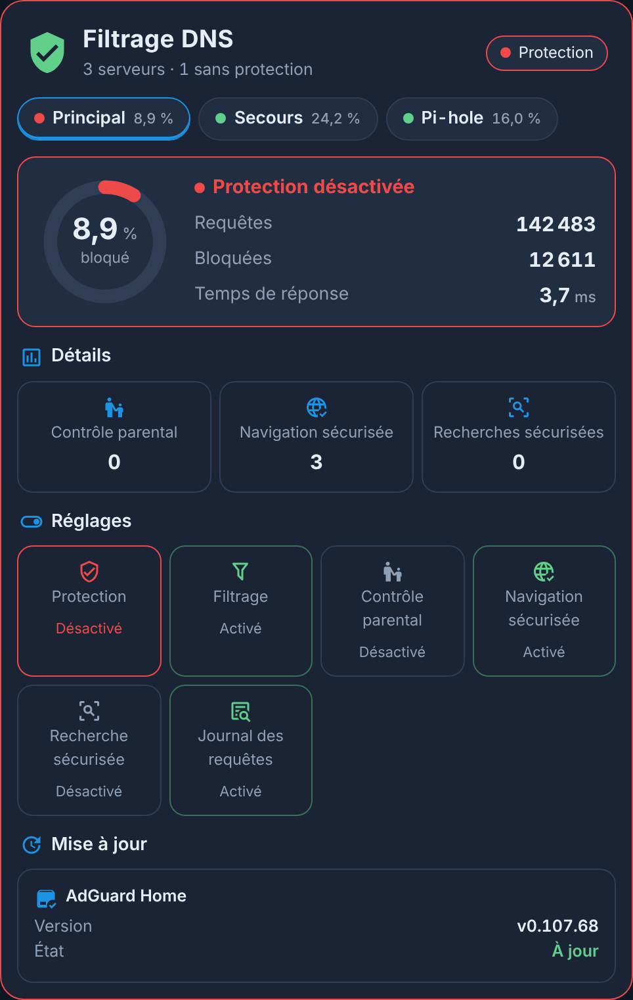
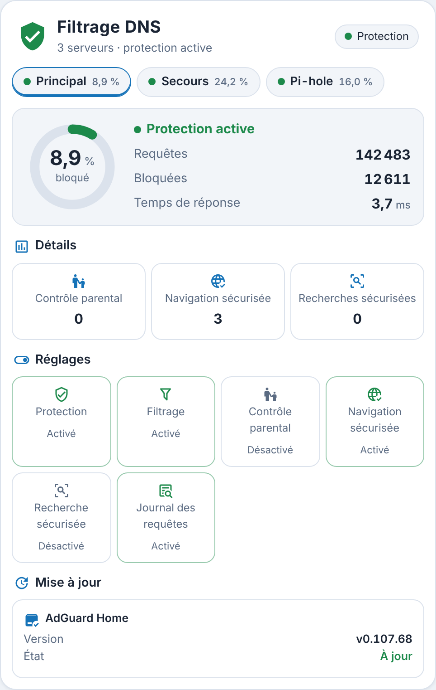
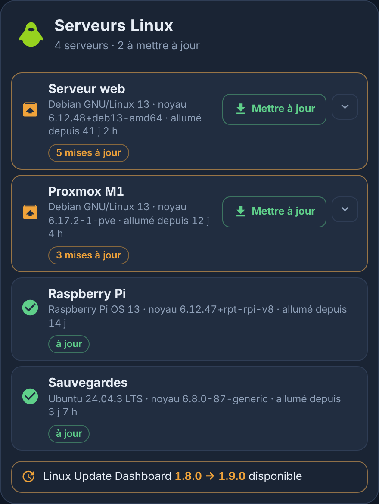
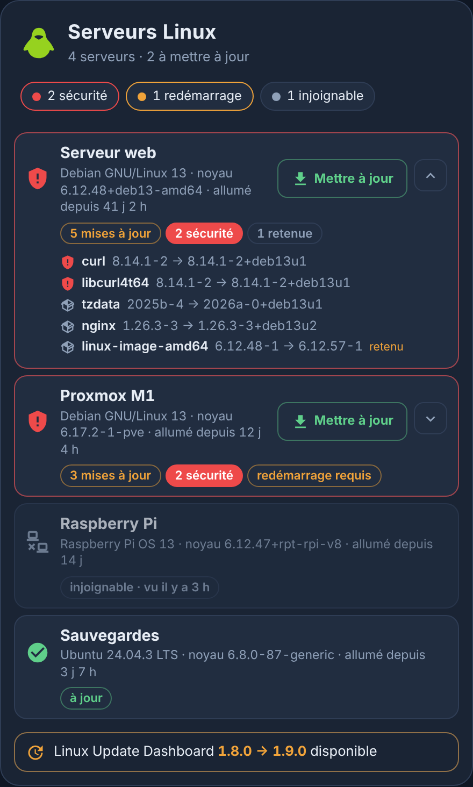
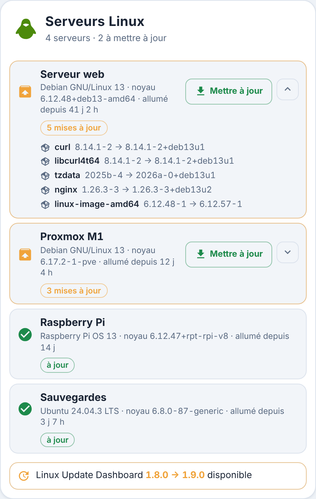

<p>
  ☕ <strong>Si cette carte vous est utile, vous pouvez soutenir le projet :</strong>
</p>

<div style="white-space: nowrap; line-height: 0;">
  <a
    href="https://www.buymeacoffee.com/Marlboro62"
    target="_blank"
    rel="noopener noreferrer"
    style="display: inline-block; text-decoration: none; vertical-align: middle;"
  ></a>&nbsp;&nbsp;<a
    href="https://ko-fi.com/M4M2QL45X"
    target="_blank"
    rel="noopener noreferrer"
    style="display: inline-block; text-decoration: none; vertical-align: middle;"
  ></a>
</div>

# Cartes Serveur HA

**Six cartes Lovelace indépendantes, dans un seul fichier**, pour surveiller l'infrastructure de Home Assistant. Elles ont le style des cartes MyElectricalData new ([Carte Enedis Linky New](https://github.com/Marlboro62/content-card-linky-new)) : thème bleu nuit, version claire, ou thème Home Assistant.

| Type | Carte |
| --- | --- |
| `custom:serveur-ha-card` | **Serveur** (Raspberry Pi, mini-PC, VM) : CPU, température, RAM, disque, réseau, uptime, ventilateur, alimentation sur 24 h, sauvegardes et Google Drive |
| `custom:serveur-ha-maj-card` | **Home Assistant** : version, mises à jour Core / Supervisor / OS, base de données, certificat SSL et applications |
| `custom:serveur-ha-nas-card` | **NAS Synology** : santé des volumes et disques, CPU, RAM, températures, ventilateur, actions, réseau et onduleur |
| `custom:serveur-ha-dns-card` | **Filtrage DNS** (AdGuard Home ou Pi-hole) : requêtes, part bloquée, temps de réponse, protection et réglages, pause, mises à jour |
| `custom:serveur-ha-linux-card` | **Serveurs Linux** ([Linux Update Dashboard](https://github.com/TheDuffman85/linux-update-dashboard)) : mises à jour en attente, sécurité, paquets, redémarrage requis, installation confirmée en deux clics |
| `custom:serveur-ha-proxmox-card` | **Proxmox VE** : nœuds, stockages, VM et conteneurs (état, CPU, RAM, uptime), mises à jour, démarrage et arrêt confirmés en deux clics |

**Pare-feu OPNsense** : la carte a son propre dépôt, [Carte OPNsense](https://github.com/Marlboro62/opnsense-card) (`custom:opnsense-card`).

*Basées sur les idées et propositions de [@WarC0zes](https://forum.hacf.fr/u/warc0zes/summary) sur le forum HACF : merci à lui !*

**Aucune dépendance** : pas de button-card, pas de browser_mod, pas d'image ni de page HTML à déposer dans `/local`. Les capteurs sont **détectés automatiquement**, en français comme en anglais, et chaque élément sans capteur est simplement masqué.

| Serveur | Home Assistant | NAS Synology |
| --- | --- | --- |
|  |  |  |

| Serveur en alerte | Clair | NAS en alerte |
| --- | --- | --- |
|  |  |  |

| Proxmox VE | Proxmox chargé, mise à jour | Proxmox clair |
| --- | --- | --- |
|  |  |  |

| Filtrage DNS | Protection coupée | Filtrage DNS clair |
| --- | --- | --- |
|  |  |  |

| Serveurs Linux | Sécurité, redémarrage, paquets | Serveurs Linux clair |
| --- | --- | --- |
|  |  |  |

*Aperçus réalisés avec la démo et des valeurs fictives (noms, adresses IP, nœuds et invités inventés).*

**[▶ Essayer la démo en ligne](https://marlboro62.github.io/serveur-ha-card/docs/demo.html)** : les 6 cartes avec des données simulées (Raspberry Pi ou VM, mises à jour, certificat SSL, NAS sain ou en panne, coupure de courant, Proxmox normal, chargé ou avec un nœud hors ligne, filtrage DNS normal ou coupé, serveurs Linux à jour ou en retard), en sombre ou clair, sur téléphone ou PC, avec le YAML à copier.

## Installation

### Avec HACS (recommandé)

1. Dans HACS, menu **⋮** → **Dépôts personnalisés**.
2. Ajoutez `https://github.com/Marlboro62/serveur-ha-card` avec le type **Tableau de bord** (Dashboard).
3. Cherchez **Cartes Serveur HA**, installez, puis rechargez la page (Ctrl+F5).

> Tant qu'il n'existe qu'une version bêta, activez **Afficher les versions bêta** dans la fenêtre de téléchargement de HACS.

### Manuellement

1. Téléchargez [`serveur-ha-card.js`](https://raw.githubusercontent.com/Marlboro62/serveur-ha-card/main/serveur-ha-card.js) (clic droit → Enregistrer sous) et copiez-le dans `/config/www/`.
2. **Paramètres → Tableaux de bord → ⋮ → Ressources → Ajouter une ressource** : URL `/local/serveur-ha-card.js`, type **Module JavaScript**.
3. Rechargez la page (Ctrl+F5).

Toutes les cartes ont un **éditeur visuel** et acceptent `theme` : `v2` (bleu nuit MyElectricalData), `auto` (clair ou sombre selon Home Assistant) ou `ha` (thème Home Assistant).

---

## Option commune à toutes les cartes

| Option | Rôle | Par défaut |
| --- | --- | --- |
| `text_size` | Taille du texte, en % (70 à 200) : toute la carte s'agrandit, texte et icônes, sans rien couper. Aussi dans l'éditeur visuel | `100` |

```yaml
type: custom:serveur-ha-dns-card
text_size: 120
```

## Carte Serveur — `custom:serveur-ha-card`

```yaml
type: custom:serveur-ha-card
title: Raspberry Pi 4 4Go
icon: mdi:raspberry-pi
icon_color: "#E30B5D"
ram_total: 3800
```

### Ce qu'elle affiche

- **En-tête** : nom, IP et température CPU, avec les voyants **Alimentation**, **Ventilateur** et **Backup**.
- **Informations** : adresses IP interne et externe, uptime (dernier reboot et dernier redémarrage de HA), ventilateur.
- **Ressources** : CPU, température, RAM, RAM libre et disque, avec des jauges colorées selon des seuils.
- **Débits réseau** : download et upload.
- **Alimentation** : historique des **24 dernières heures** en 24 segments d'une heure (vert = OK, rouge = sous-tension, gris = inconnu), avec la durée de chaque état au survol.
- **Sauvegardes / Google Drive Backup** : taille des sauvegardes, état de la dernière sauvegarde automatique, espace utilisé, dates de la dernière et de la prochaine.

### Capteurs détectés

| Élément | Intégration | Exemple d'entité |
| --- | --- | --- |
| CPU, température, RAM, RAM libre, disque, débits, dernier démarrage | **System Monitor** | `sensor.system_monitor_utilisation_du_processeur` |
| Disque (repli sans System Monitor) | Supervisor | `sensor.home_assistant_host_disk_used` |
| IP interne | **Local IP** ou System Monitor | `sensor.local_ip` |
| IP externe | **DNS IP**, ou attribut `wan_ipaddress` / `external_ip` d'un routeur | `binary_sensor.wan_status` |
| Redémarrage de HA | **Uptime** (nom libre) | `sensor.temps_online` |
| Alimentation | **Raspberry Pi Power Supply Checker** | `binary_sensor.rpi_power_status` |
| Ventilateur | une entité `fan.*` (ex. `fan.rpi_cooling_fan`), ou un capteur en rpm ou % via `fan:` | `fan.rpi_cooling_fan` |
| Sauvegardes | **Sauvegarde** (backup) | `event.backup_sauvegarde_automatique` |
| Google Drive | **Google Drive** | `sensor.xxx_used_storage` |

Les capteurs de System Monitor sont souvent **désactivés par défaut** : activez-les dans **Paramètres → Appareils et services → System Monitor**.

### Options

| Option | Rôle | Défaut |
| --- | --- | --- |
| `title`, `subtitle` | Titre et sous-titre | `Serveur`, `Serveur Home Assistant` |
| `icon`, `icon_color` | Icône de l'en-tête et sa couleur | logo de la carte |
| `fan` | Ventilateur : `fan.*` ou capteur en rpm / % | détecté (`fan.*rpi*`, `*cooling*`…) |
| `ram_total` | RAM totale en MiB : la barre « RAM libre » devient libre / total | — |
| `net_max` | Pleine échelle des barres réseau (Mbit/s) | `100` |
| `cpu_warn` / `cpu_alert`, `ram_warn` / `ram_alert`, `disk_warn` / `disk_alert` | Seuils orange / rouge en % | `70/90`, `75/90`, `75/90` |
| `temp_warn` / `temp_alert` | Seuils de température | `60` / `75` °C |
| `backup_title` | Titre de la section sauvegardes | `Google Drive Backup` si Google Drive, sinon `Sauvegardes` |
| `navigation_path` | Page ouverte en cliquant sur le titre | fiche de l'IP |
| `ip_ext_attribute` | Attribut portant l'IP externe | détecté |
| `show_info`, `show_resources`, `show_network`, `show_power`, `show_backup` | Afficher chaque section | `true` |
| `entities` | Capteurs choisis à la main (voir ci-dessous) | — |

Clés de `entities:` : `cpu`, `temperature`, `ram`, `ram_free`, `disk`, `disk_used`, `disk_total`, `net_in`, `net_out`, `ip`, `ip_ext`, `last_boot`, `ha_start`, `power`, `fan`, `backup_state`, `backup_event`, `backup_last`, `backup_next`, `drive_size`, `drive_used`, `drive_total`, `drive_count`.

Un **appui long** sur la tuile du ventilateur (entité `fan.*`) l'allume ou l'éteint.

---

## Carte Home Assistant — `custom:serveur-ha-maj-card`

```yaml
type: custom:serveur-ha-maj-card
```

- **En-tête** : version du Core, voyants **Core**, **Supervisor** et **OS** (vert = à jour, orange = mise à jour disponible).
- **Mises à jour système** : version installée et nouvelle version disponible.
- **Informations** : taille de la base de données (`sensor.*_db_size`) et expiration du **certificat SSL** (intégration *Certificate Expiry*), vert au-delà de 30 jours, orange en dessous, rouge sous 20 jours.
- **Applications** : les mises à jour des **add-ons**, trouvées automatiquement avec leur icône, celles à mettre à jour en premier.

| Option | Rôle | Défaut |
| --- | --- | --- |
| `title`, `subtitle` | Titre et sous-titre | `Home Assistant`, `Serveur domotique` |
| `database`, `ssl` | Capteurs de la base et du certificat | détectés |
| `ssl_warn` / `ssl_alert` | Seuils du certificat, en jours | `30` / `20` |
| `include_hacs` | Ajouter les mises à jour HACS | `false` |
| `include_devices` | Ajouter les firmwares d'appareils (Zigbee, ESPHome…) | `false` |
| `apps` | Liste choisie à la main (`entity`, `name`, `icon`, `picture`) | add-ons détectés |
| `exclude` | Entités `update.*` à masquer | — |
| `updates_first` | Mises à jour en attente en premier | `true` |
| `show_system`, `show_info`, `show_apps` | Afficher chaque section | `true` |

---

## Carte NAS Synology — `custom:serveur-ha-nas-card`

```yaml
type: custom:serveur-ha-nas-card
title: Synology DS214+
volume_name: HDD 4 To
ups_name: Green Cell 600VA
actions:
  - switch.ds214
  - entity: switch.minipc
    name: Mini PC N95
```

- **En-tête** : NAS disponible ou non, IP, état du volume, voyants **NAS**, **HDD**, **Sécurité** et **UPS**.
- **Informations** : adresses IP, santé (volume, sécurité), uptime et **DSM** (version installée, À jour ou version disponible). Un clic sur **Santé** ouvre l'**état de chaque disque** (état, SMART, secteurs défectueux, durée de vie, température).
- **Ressources** : CPU, RAM, chaque volume et les **disques USB** branchés sur le NAS.
- **Températures et ventilation** : NAS et chaque disque (orange à 45 °C, rouge à 55 °C), mode du ventilateur (**appui long** : mode suivant).
- **Actions** : **Éteindre / Allumer** le NAS (arrêt propre par DSM quand il est allumé, Wake on LAN ou prise quand il est éteint), **Redémarrer** (confirmation en deux clics pour les deux) et vos interrupteurs (**appui long** : marche / arrêt).
- **Débits réseau** et **onduleur** NUT : état, tension d'entrée et de sortie, charge, batterie.

Les entités sont trouvées via l'intégration **Synology DSM**, pour **tous les volumes et tous les disques**. Les états (Normal, Dégradé, En panne…) sont traduits en français.

| Option | Rôle | Défaut |
| --- | --- | --- |
| `device` | Appareil Synology DSM | le premier trouvé |
| `prefix` | Préfixe des entités, si le registre ne suffit pas | `diskstation` |
| `title`, `icon`, `icon_color` | En-tête | nom de l'appareil, `mdi:nas` |
| `tracker` | `device_tracker` du NAS (adresse IP) | détecté |
| `ip` | Adresse IP du NAS (ex. `192.168.1.20`) ou entité qui la porte | traceur, sinon adresse de l'intégration Synology DSM |
| `dsm_update` | Entité de mise à jour DSM (`null` pour masquer la tuile) | détectée |
| `volume_name` | Nom du volume 1 | `Volume 1` |
| `fan` | Mode du ventilateur (`select`) | détecté |
| `reboot` | Bouton de redémarrage (`null` pour le masquer) | détecté |
| `shutdown` | Bouton d'arrêt du NAS, affiché quand le NAS est allumé (`null` pour le masquer) | bouton « Arrêter » de Synology DSM |
| `power_on` | Allumage du NAS, affiché quand il est éteint : bouton **Wake on LAN**, prise (`switch`) ou script | bouton Wake on LAN dont le nom contient celui du NAS |
| `usb` | Disques USB dans Ressources : capteurs d'espace utilisé en % (`entity`, `name`, `icon`) | capteurs DSM en % dont le nom contient « usb » |
| `actions` | Interrupteurs et boutons (`entity`, `name`, `icon`) | — |
| `ups_device`, `ups_name`, `ups` | Onduleur NUT (appareil, nom, capteurs) | le premier trouvé |
| `net_max` | Pleine échelle des barres réseau (Mbit/s) | `1000` |
| `temp_warn` / `temp_alert` | Seuils de température | `45` / `55` °C |
| `navigation_path` | Page ouverte en cliquant sur le titre | — |
| `show_info`, `show_resources`, `show_thermal`, `show_actions`, `show_network`, `show_ups` | Afficher chaque section | `true` |

D'autres exemples sont dans [`exemples/`](exemples/).

## Carte Proxmox VE — `custom:serveur-ha-proxmox-card`

```yaml
type: custom:serveur-ha-proxmox-card
```

Tout est détecté à partir de l'intégration **Proxmox VE** de Home Assistant (**Paramètres › Appareils et services › Ajouter une intégration**), en français comme en anglais.

- **En-tête** : nombre de nœuds et d'invités en marche, voyants **Nœuds** (rouge si un nœud est hors ligne) et **Mise à jour**.
- **Un onglet par nœud**, avec le nombre d'invités en marche et une flèche orange quand une mise à jour Proxmox est disponible.
- **Nœud** : en ligne ou hors ligne, uptime, version de Proxmox et mise à jour, jauges **CPU** et **RAM** (Go utilisés sur le total).
- **Stockage** : chaque stockage du nœud (local, local-lvm, sauvegardes…), orange à 80 %, rouge à 90 %.
- **Invités** : une ligne par VM ou conteneur LXC, avec son état, son uptime, le CPU et la RAM ; ceux en marche d'abord, ceux arrêtés en grisé. Un clic ouvre la fiche Home Assistant.
- **Boutons** : **Démarrer** un invité arrêté, **Redémarrer** ou **Arrêter** un invité en marche, **Tout démarrer**, **Redémarrer** ou **Arrêter** le nœud. Chaque bouton demande **un second clic dans les 5 secondes** pour confirmer : le premier clic l'arme (coche orange), le second envoie l'ordre. Aucun bouton quand le nœud est hors ligne.
- **Stockage par nœud** : l'intégration crée un seul appareil par nom de stockage pour tous les nœuds ; la carte retrouve le nœud de chaque série de capteurs dans leur identifiant unique (registre des entités).

> Pour un conteneur, « Arrêter » de l'intégration Proxmox VE est un **arrêt immédiat** (Stop), pas un arrêt propre du système. Pour un invité qui écrit sur disque (base de données, NAS), préférez l'arrêt depuis Proxmox.
- **Onduleur** : si un onduleur est suivi par l'intégration **Network UPS Tools (NUT)**, la carte affiche son état (secteur ou batterie), les tensions d'entrée et de sortie, la charge et la batterie, avec un voyant **UPS** dans l'en-tête (rouge sur batterie). Pratique quand le serveur Proxmox est protégé par l'onduleur, sans NAS.
- **Protection** : la VM qui fait tourner Home Assistant (nom contenant « haos » ou « home assistant ») n'a **ni arrêt ni redémarrage**, et son nœud non plus, pour ne pas couper Home Assistant d'un clic. L'option `protect` choisit d'autres invités.

| Option | Rôle | Défaut |
| --- | --- | --- |
| `title`, `icon`, `icon_color` | En-tête | `Proxmox`, `mdi:server-network` |
| `nodes` | Nœuds affichés (liste de noms) | tous |
| `protect` | Invités sans arrêt ni redémarrage (liste de noms) | la VM Home Assistant |
| `sort` | Ordre des invités : `status` (en marche d'abord), `name`, `cpu`, `ram` | `status` |
| `hide_stopped` | Masquer les invités arrêtés | `false` |
| `ups_device`, `ups_name`, `ups` | Onduleur NUT (appareil, nom, capteurs) | le premier trouvé |
| `show_node`, `show_storage`, `show_guests`, `show_actions`, `show_ups` | Afficher chaque section, et les boutons | `true` |
| `theme` | `v2`, `auto` ou `ha` | `v2` |

```yaml
type: custom:serveur-ha-proxmox-card
nodes: [pve1, pve2]
protect: [home-assistant, routeur]
sort: cpu
```

## Carte Filtrage DNS — `custom:serveur-ha-dns-card`

```yaml
type: custom:serveur-ha-dns-card
```

Compatible avec les intégrations **AdGuard Home** et **Pi-hole** de Home Assistant (Pi-hole 5 et 6), en français comme en anglais. Plusieurs serveurs, même de types différents, s'affichent en **onglets**, avec la part bloquée de chacun. Deux serveurs au même nom d'appareil (« AdGuard Home ») prennent le nom de leurs entités (`dns_adguard_home_principal` → « Principal »).

- **En-tête** : nombre de serveurs, voyants **Protection** (rouge si un serveur ne filtre plus) et **Mise à jour**.
- **Anneau** : part des requêtes bloquées, état de la protection, requêtes, requêtes bloquées et temps de réponse (AdGuard Home).
- **Détails**, selon ce que fournit le serveur : contrôle parental, navigation et recherches sécurisées (AdGuard Home) ; clients actifs, domaines bloqués, requêtes en cache et transférées, domaines uniques (Pi-hole).
- **Réglages** : un clic active ou coupe un interrupteur (filtrage, contrôle parental, navigation sécurisée, recherche sécurisée, journal). **Couper la protection** (AdGuard Home) ou **le blocage** (Pi-hole) demande **un second clic dans les 5 secondes**. Pi-hole : tuiles **Pause 5 min** et **Pause 30 min**.
- **Mise à jour** : version installée ou version disponible (Core, FTL et Web pour Pi-hole).

> Quand la protection d'AdGuard Home change d'état, l'intégration peut afficher quelques secondes **Filtrage** et **Journal des requêtes** comme désactivés : ils reviennent seuls au rafraîchissement suivant. Vérifiez dans AdGuard Home avant de les réactiver.

| Option | Rôle | Défaut |
| --- | --- | --- |
| `title`, `icon`, `icon_color` | En-tête | AdGuard Home, Pi-hole ou Filtrage DNS |
| `servers` | Serveurs affichés, dans cet ordre : appareils, ou `{ device, name }` | tous |
| `pause_minutes` | Pauses Pi-hole proposées (minutes) | `[5, 30]` |
| `show_stats`, `show_details`, `show_switches`, `show_update` | Afficher chaque partie | `true` |
| `theme` | `v2`, `auto` ou `ha` | `v2` |

## Carte Serveurs Linux — `custom:serveur-ha-linux-card`

```yaml
type: custom:serveur-ha-linux-card
```

Elle affiche les serveurs suivis par **[Linux Update Dashboard](https://github.com/TheDuffman85/linux-update-dashboard)** (Debian, Ubuntu, Raspberry Pi OS, Fedora, Arch…), une application qui vérifie les mises à jour de vos machines par SSH. Voir le [tutoriel sur le forum HACF](https://forum.hacf.fr/t/tuto-linux-update-dashboard-gerer-et-centraliser-les-mises-a-jour-de-vos-serveurs-linux-sous-ha/77620).

**Prérequis** : dans Linux Update Dashboard, **Settings → Notifications → MQTT**, activez l'option **Home Assistant**. Chaque serveur devient une entité `update.*` dans Home Assistant (intégration MQTT), que la carte **détecte toute seule**. Aucune autre carte (Mushroom, auto-entities, card-mod) n'est nécessaire.

- **En-tête** : nombre de serveurs, voyants **Sécurité**, **Redémarrage** et **Injoignable**.
- **Un bloc par serveur**, trié par urgence (sécurité, puis nombre de mises à jour) : système et version, noyau, durée d'allumage, mises à jour en attente, dont **sécurité** (rouge) et **retenues**, **redémarrage requis**, serveur **injoignable** (avec l'heure du dernier contact), mise à jour **en cours**.
- **Paquets** : la flèche déplie la liste des paquets en attente, version actuelle → nouvelle version (40 au plus).
- **Mettre à jour** : installe les mises à jour du serveur, avec **un second clic dans les 5 secondes** pour confirmer. Le bouton n'apparaît que si les commandes MQTT sont activées dans Linux Update Dashboard.
- **Application** : signale une nouvelle version de Linux Update Dashboard lui-même.
- Un clic sur un serveur ouvre la fiche de l'entité dans Home Assistant.

| Option | Rôle | Défaut |
| --- | --- | --- |
| `title`, `icon`, `icon_color` | En-tête | Serveurs Linux, `mdi:linux` |
| `entities` | Serveurs affichés, dans cet ordre (entités `update.*`) | tous, détectés |
| `exclude` | Entités à masquer | — |
| `show_uptodate` | Afficher aussi les serveurs à jour | `true` |
| `show_os`, `show_packages`, `show_actions`, `show_app` | Système et noyau, liste des paquets, bouton Mettre à jour, mise à jour de l'application | `true` |
| `theme` | `v2`, `auto` ou `ha` | `v2` |

*Idée de [@cob94440](https://github.com/cob94440).*

## Support

Questions et problèmes : uniquement via les [issues GitHub](https://github.com/Marlboro62/serveur-ha-card/issues).

## Voir aussi

[Carte OPNsense](https://github.com/Marlboro62/opnsense-card) · [Carte Onduleur UPS](https://github.com/Marlboro62/onduleur-ups-card) · [Carte Enedis Linky New](https://github.com/Marlboro62/content-card-linky-new) · [Cartes Linky Énergie](https://github.com/Marlboro62/linky-energie-cards)

## Licence

MIT. Idées et propositions : [@WarC0zes](https://forum.hacf.fr/u/warc0zes/summary) (forum HACF).
